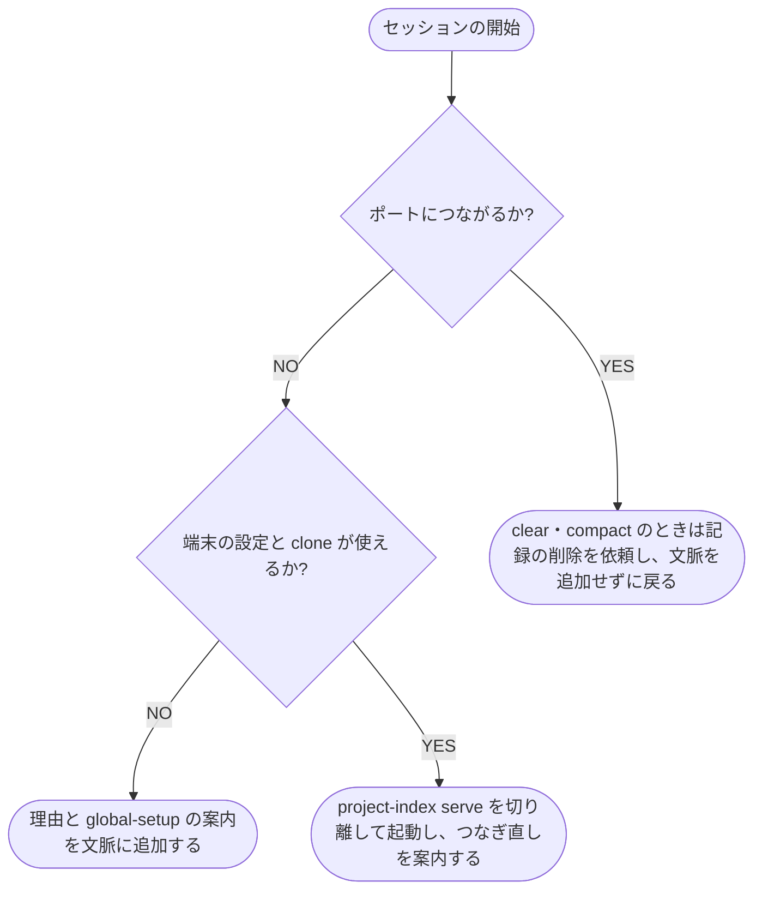

# プラグイン

プラグインが配る .mcp.json・フック・スキルと、起動・書き込みの後の通知・作業場所の受け渡しの仕組み

## 配るもの

project-index のリポジトリはマーケットプレイスで、プラグイン `project-index` を 1 つ載せています。
利用者はユーザースコープで入れるだけで、どの作業場所でも project-index を使えます。
各リポジトリはプラグインを持たず、ai-monitor にも依存しません。

| 配るもの | 内容 |
| --- | --- |
| `.mcp.json` | 文書の MCP `project-index`（`http://127.0.0.1:${PROJECT_INDEX_PORT:-8786}/mcp`）と、管理の MCP `project-index-admin`（`/_admin/mcp`） |
| SessionStart のフック | 落ちているサーバーを起動し、`/clear`・圧縮のときは返却済みの記録の削除を依頼する |
| PreToolUse のフック | 文書の MCP のツールの呼び出しに、作業場所とセッションを入れる |
| PostToolUse のフック | 配信元の範囲のファイルを書き込んだ後に、管理用の YAML の行（エイリアス・ルールの索引を含む）の修正を促す通知を文脈に追加する |
| スキル `/project-index:global-setup [クローンのパス]` | 端末の設定・Claude Code の env・起動を用意する |
| スキル `/project-index:setup [path]` | フォルダを配信元として登録し、2 回目以降は範囲のファイルと管理用の YAML を突き合わせる。手順は [配信元を登録する](./配信元を登録する.md) を文書の MCP で取得して進める |
| スキル `/project-index:feedback` | 会話で利用者が伝えた指摘を、ルール・エイリアス・文書として登録する。手順は [会話の指摘を登録する](./会話の指摘を登録する.md) を文書の MCP で取得して進める |

スキルの使い方は [project-indexを入れる](./project-indexを入れる.md) と [配信元を配信する](./配信元を配信する.md)、管理の MCP の引数は [管理のMCP](./管理のMCP.md) にあります。

## 起動の仕組み

SessionStart のフックは、セッションが始まるたびに（`startup`・`resume`・`clear`・`compact`・`fork`）実行されます。
フックは Python の標準ライブラリだけで動き、`uv` を前提にしません。

<!-- map: {"title": "セッションの開始のフックの判定"} -->

<!-- /map -->

| 判定・動作 | 内容 |
| --- | --- |
| ポートにつながるか | `127.0.0.1:${PROJECT_INDEX_PORT:-8786}` への接続を 0.5 秒で打ち切る |
| 端末の設定と clone が使えるか | 端末の設定・`clone`・`{clone}/.venv/bin/python` のどれかが無いときは起動せず、理由と `/project-index:global-setup` の案内を文脈に追加する |
| 起動 | `PROJECT_INDEX_CONFIG` が指す端末の設定の `clone:` の行から `{clone}/.venv/bin/python -m project_index serve` を組み立て、入出力を切り離して待たずに戻る。起動したセッションでは MCP の接続が間に合わないので、`/mcp` でつなぎ直す |
| 同時の起動 | 待ち受けるのは 1 つだけで、後から起動したプロセスはポート使用中で終わる |

どの失敗でも、フックは終了コード 0 で戻り、失敗の理由を文脈に追加します。

## 待ち受けているとき

つながったときは、フックは文脈を追加せずに戻ります。
使える配信元と警告は文書の MCP の引数なしの `describe()`、ツールの使い方は文書の MCP の `instructions` で取得します（[文書のMCP](./文書のMCP.md)）。

`source` が `clear`・`compact` のときだけ、フックは `POST /_admin/session-start` に `session_id`・`agent_id`・`reason` を送信し、そのセッションの返却済みの記録を削除させます。
文書の MCP が前に返した文書の本文を省かなくなります。
依頼が 3 秒で返らないときや 200 以外のときは、削除できなかったことと、`repeat_seen: true` で取り直せることを文脈に追加します。

`POST /_admin/session-start` は、フックだけが呼ぶ入口です。

範囲のファイルを作った・削除した・改名したときは、エージェントが管理用の YAML の行を修正します。
ずれは `describe()` の注意で件数が知らされます。

## 書き込みの後の通知

PostToolUse のフックは、Write・Edit・NotebookEdit と MCP のツールの呼び出しの後に実行されます。
文書の MCP と管理の MCP のツールは、管理用の YAML を自分で扱うので対象にしません。

フックは、ツールの入力から書き込んだファイルのパスを集め、`POST /_admin/post-write` に送信します。
通知するかと文面は、索引のサーバーが判定します。

| 判定 | 内容 |
| --- | --- |
| 通知するファイル | 配信元の管理用の YAML の範囲（`documents[].paths`）に該当するファイル。管理用の YAML に行が無ければ行の追加を、行があれば名前・概要文・タグ・関連の見直しを促す |
| 通知しないファイル | 配信元の外のファイル、範囲の外のファイル、管理用の YAML と配信元の設定そのもの、YAML の文書、Git が無視するファイル |
| 追加の 1 行 | 配信元の設定に `alias_type` を持つ行があればエイリアスの見直しを、配信元のフォルダの直下に `rules.yaml` があればルールの索引のエントリの見直しを促す |
| 1 回だけ | 同じセッションで通知したファイルには、もう一度書き込んでも通知しない。`/clear`・圧縮の後は、`POST /_admin/session-start` が返却済みの記録と一緒に通知の記録も削除する |

通知は文脈に追加するだけで、書き込みを止めません。
サーバーにつながらないときや配信元を読み込んでいる間は、何も出さずに終了コード 0 で戻ります。

## 作業場所の受け渡し

PreToolUse のフックは、文書の MCP（`project-index`）のツールの呼び出しだけに当たります。
管理の MCP（`project-index-admin`）のツールには当たりません。

フックは、ツールの入力に `cwd`・`session_id`・`agent_id`（サブエージェントのときだけ）を入れて返します。
エージェントが入れた値があっても、フックの値で上書きします。
入力の残りのキーは変えません。

フックは許可の判定に `allow` を返し、auto モードでも書き換えた呼び出しが拒否されないようにします。
利用者の設定の deny・ask のルールは、フックの返却によらず効きます。
入力が JSON として読めないときは、何も出さずに戻ります。

入れた `cwd` が、配信元の権限と読み書きの先を決めます。
仕組みは [配信元と権限](./コアコンセプト-配信元と権限.md) にあります。
