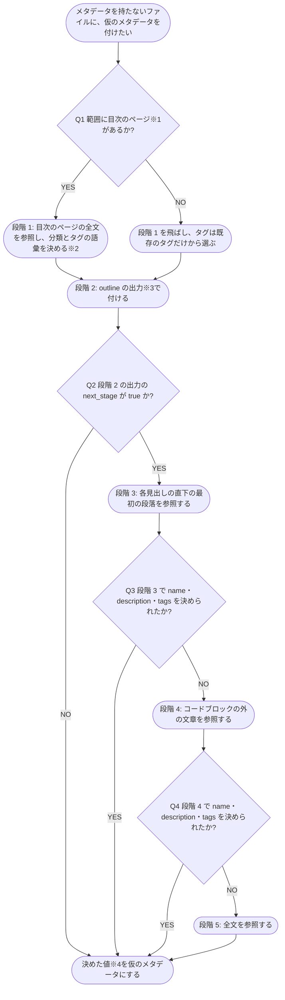
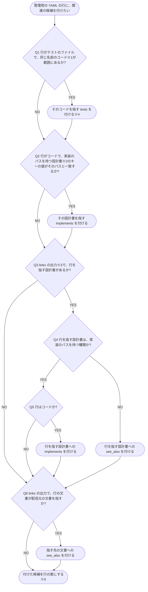
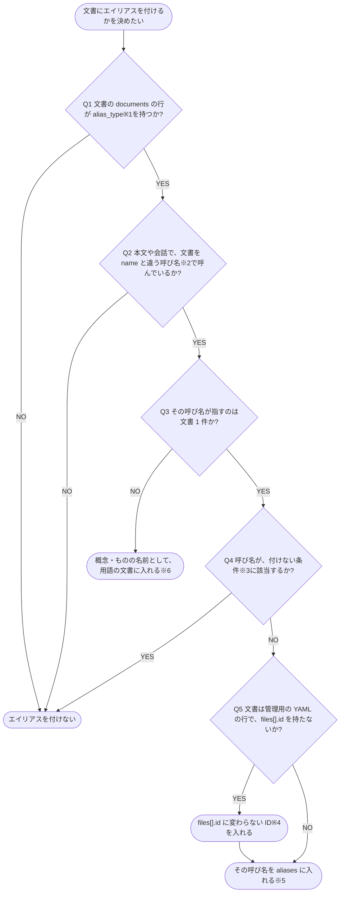

# メタデータを付ける基準

配信元の管理用の YAML の行に、仮のメタデータ（name・description・tags）・関連の候補・エイリアスを付け、偏りと中身の変わったファイルを見直す基準

[配信元を登録する](./配信元を登録する.md) の手順と、作業の途中でファイルを足した・書き換えたときに使用します。
`{clone}` は端末の設定の `clone`、`{path}` は配信元のフォルダです。

## 仮のメタデータ

仮のメタデータは、次の判定フローチャートの段階で中身を参照して付ける。管理用の YAML の行が既にメタデータを持つファイルには付けない。

### 仮のメタデータの判定フローチャート

<!-- map: {"title": "仮のメタデータの段階"} -->

<!-- /map -->

- **※1 目次のページ**: `index`・`README`・ファイルへのリンクを多く持つページ
- **※2 語彙**: ファイルを指すリンクの文字列と同じ行の説明は、そのファイルの `name`・`description` の材料にする
- **※3 outline の出力**: `{clone}/.venv/bin/python -m project_index outline --root {path} --paths {ファイル}`（`--paths` は繰り返せる）の出力（1 ファイル 1 行の JSON）。`existing_description` があれば材料にする
- **※4 決めた値**: 次の基準で決める
  - `name`: 何のファイルかを表す日本語の名詞句。クラス名・ファイル名の繰り返しにしない
  - `description`: 「何を受け持つか」と「どんなときに参照するか」の 1 文。関数の一覧・実装の手順は入れない
  - `tags`: `topic`（扱う概念）と `tool`（使用するライブラリ・外部サービス）で、付けるタグがあるときだけ付ける。既存のタグ（`search_docs` の `group_by: tags`）と段階 1 の語彙から選ぶ

## メタデータの偏りの見直し

- 仮のメタデータを付けた後に、`{clone}/.venv/bin/python -m project_index skew --root {path} --files-yaml {管理用の YAML} --draft {行の案}` でメタデータの偏りを洗い出す
  - `--files-yaml` は管理用の YAML ごとに繰り返す。行の案は、追加する行と見直した行の `path`（`{path}` からのパス）・`description`・`tags` を 1 行ずつ持つ JSON Lines のファイル
  - 管理用の YAML が確認の時点（`checkpoint`）を持つときは `--only-draft` も渡す
  - 出力の `similar_descriptions`（ほぼ同じ `description` の組）・`singleton_tags`（1 件だけのタグ）・`dominant_tags`（半数以上に付くタグ）ごとに、今の値と見直しの案を作る

## 中身が変わったファイルの見直し

- `{config}` があるときは、`records: files` の行ごとに `{clone}/.venv/bin/python -m project_index changed --root {path} --files-yaml {管理用の YAML}` で、確認の時点の後に中身が変わった行のファイルを求める
  - 出力の `files` を `## 仮のメタデータ` の段階 2〜5 で読み、メタデータの新しい案を作る。`files` に無いファイルは読まない
  - 標準エラーに起点を切り替えた旨が出たら、候補の表と一緒に示す

## 関連の候補

追加する行と、関連を持たない行に、次の判定フローチャートで関連の候補を付ける。

### 関連の候補の判定フローチャート

<!-- map: {"title": "関連の候補"} -->

<!-- /map -->

- **※1 同じ名前のコード**: テストのファイル名から `test_` の接頭辞（`_test`・`.test` の接尾辞）を除いた名前のコード
- **※2 実装のパスを持つ設計書**: 実装のパスを持つ設計書の種類とキー（[配信元を登録する](./配信元を登録する.md) の手順で聞いたもの）の文書を `search_docs`（`filter` は `kind`、`format: json`）で引く。種類とキーが無しなら Q2 は NO にする
- **※3 links の出力**: `{clone}/.venv/bin/python -m project_index links --root {path} --paths {配信元の範囲の glob}` の出力（指す側のファイルごとの `targets`）
- **※4 tests の `to`**: 文書の ID で、指すコードの配信元の直下からの拡張子付きのパス
- **※5 行の案**: 候補は全て管理用の YAML の行の側に付ける。設計書 → コードの向きの関連は付けない

## エイリアス

行を追加したときと、本文や会話で文書が `name` と違う呼び名で呼ばれているのに気づいたときに、次の判定フローチャートでエイリアス（`aliases`）を付けるかを決める。

### エイリアスの判定フローチャート

<!-- map: {"title": "エイリアス"} -->

<!-- /map -->

- **※1 alias_type**: [設定](./設定.md) の `documents[].alias_type`。`alias_type` を持たない行の文書の `aliases` は、`search_docs` の `term`・`list_match_words`・alias-inject の照合のどれにも使用されない
- **※2 name と違う呼び名**: 略称・英語名・改名する前の `name` など、本文や会話でその文書を指す単語として使用された実例のある単語。作成したばかりの文書は、作成のきっかけの会話・Issue で呼んだ名前を実例にする
- **※3 付けない条件**: 次のどれかに該当する呼び名
  - 別の意味の文章でも使用される一般語（設定・手順など）。特定の文脈でだけその文書を指すなら、文書の照合条件（管理用の YAML の行は `files[].inject_when`）にその文脈を記載して Q4 を NO にする
  - 1〜2 文字の単語か、ほかの単語の一部としてよく出る単語
  - NFKC と `casefold` で `name` かほかの呼び名と同じ単語になる表記の揺れ
  - ほかの文書の `name` か `aliases` に既にある単語。指す文書を 1 件に決めて片方だけに入れる
- **※4 変わらない ID**: 管理用の YAML の行は、`files[].id` を持つときだけエイリアスとして照合される。ファイルを改名しても変えない ID にする
- **※5 aliases**: エイリアスのキーは alias-inject のスキーマに従う。違反した文書は、`check_project` と起動時に警告され、照合から除外される
- **※6 用語の文書**: `alias_type` が `term` の行の文書（用語集）。既存の用語の `aliases` に入れるか、1 用語 1 件で新規作成する
