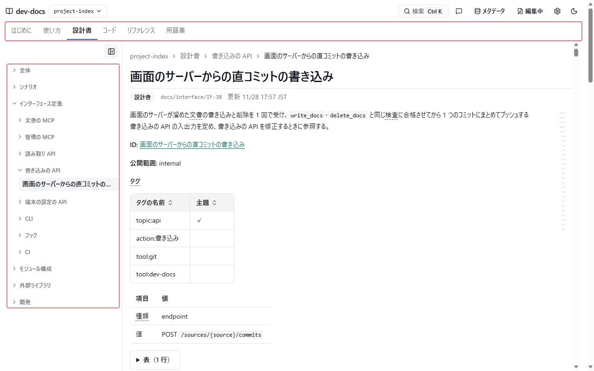
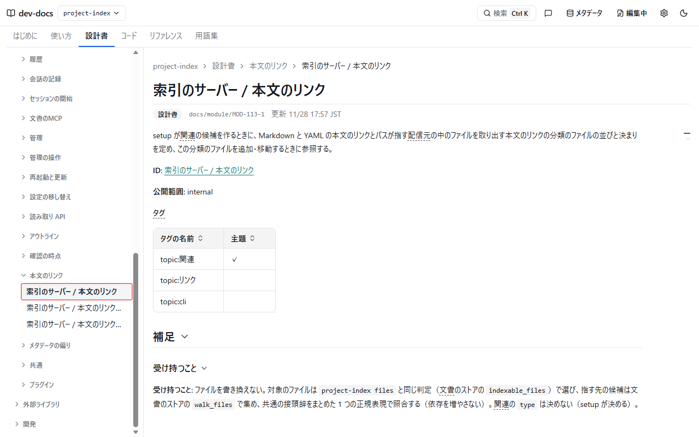
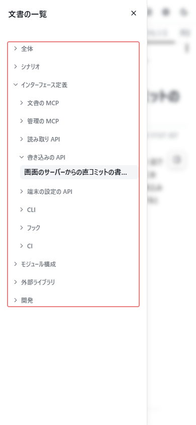

# 索引のサーバー

## 現状

| 分類 | ページ / ファイル | 概要 | 補足 |
| --- | --- | --- | --- |
| 設定 | [project-index.yaml](https://github.com/shuhei1101/project-index/blob/2588d67cf5b95cb1a593cca4cf5189440a502ae1/project-index.yaml) | 配信元の設定。`nav` が dev-docs の画面のタブとサイドバーを決める | 更新対象 |

## 変更方針

| 対象 | 方針 | 補足 |
| --- | --- | --- |
| インターフェース定義 | グループ `インターフェース定義` の子に、機能のグループ（文書の MCP・管理の MCP・読み取り API・書き込みの API・端末の設定の API・CLI・フック・CI）を並べる。最後に `auto` を残し、`page` で並べていない文書を親のグループの末尾に出す | 書き込みの API・CI は、どのグループにも当てはまらない文書のために追加した |
| `page` で並べていないインターフェース定義 | 配信元の設定の原本の取得を読み取り API、画面のサーバーからの直コミットの書き込みを書き込みの API、本文が指すファイルの一覧・メタデータの偏りの一覧を CLI、書き込みの後の通知の判定・ツール実行後のフックをフック、テストの全件実行を CI に並べる | 書き込みの後の通知の判定は、フックが呼ぶ `/_admin` のエンドポイントで、セッションの開始と同じくフックに並べる |
| モジュール構成 | 要件の `未確定` の案 A。グループ `モジュール構成` の子に、分類のグループを今の順で並べる | - |
| サイドバーに並ばないモジュール構成の分類 | 書き込みの後の通知を書き込みの後に、本文のリンク・メタデータの偏りを確認の時点の後に追加する | 3 つとも setup と書き込みの流れで隣の分類と一緒に使用する |
| 他のグループ | 判定フローチャート『サイドバーのグループの分け方』の結果、分けない | 下の表 |

| グループ | 判定 | 結果 |
| --- | --- | --- |
| 外部ライブラリ（11 件） | Q1: 主題のタグは全て `topic:ライブラリ` で NO。Q2: 機能を表す項目なしで NO。Q3: 1 つのフォルダで NO。Q4: 主題のタグを持たない sqlite3 があるが、付けても `topic:ライブラリ` で分かれない | 分けない |
| シナリオ（17 件） | Q1: 主題のタグは 10 種類に分かれるが、4 種類は 1 件だけで、残りも 2〜3 件ずつ。タグで分けると `topic:api`・`topic:文書` のように利用者の作業の単位にならず、手順の順に並べた今の順が崩れる | 分けない（レビューで確認） |
| 全体・開発・はじめに・使い方・リファレンス・用語集 | 4 件以下の `page` を手順の順に並べたグループで、Q1〜Q3 は NO | 分けない |
| コード | タグの `auto.group_by` で既に 2 階層 | 変えない |

## 実装

| 項目 | 内容 |
| --- | --- |
| 撮った画面の場面 | 作業ブランチの `project-index.yaml` だけを配る一時の索引のサーバーと dev-docs の画面のサーバーを空きポートで起動して撮った。`docs/interface/IF-38.yaml`（インターフェース定義 › 書き込みの API を開いた場面。`1280x800`・`390x844` で文書の一覧を開いた場面）、`docs/module/MOD-113-1.yaml`（モジュール構成 › 本文のリンクを開いた場面とスクロールした後。`1280x800`・`768x1024`） |
| 点検 | 管理の MCP の `check_project`: 違反なし・どの文書にも該当しない `auto.filter` の警告なし |

## テスト結果

### 単体

なし。
コードを変えず、規約『V字モデル』の対応表で `project-index.yaml` に対応する単体テストが無い。

### 結合テストの実行範囲

| 変更したファイル | 結果 | 実行する結合テスト | 結合テストが無いエントリーポイント |
| --- | --- | --- | --- |
| `docs/pr/303/README.mark.md` | R7 | - | - |
| `docs/pr/303/confirmations.yaml` | R7 | - | - |
| `docs/pr/303/requirements.yaml` | R7 | - | - |
| `docs/pr/303/tasks.yaml` | R7 | - | - |
| `docs/pr/303/要件.mark.md` | R7 | - | - |
| `docs/pr/303/索引のサーバー.mark.md` | R7 | - | - |
| `docs/pr/303/画像/if-38-drawer_390x844.png` | R7 | - | - |
| `docs/pr/303/画像/if-38-top_1280x800.png` | R7 | - | - |
| `docs/pr/303/画像/mod-113-1-current_1280x800.png` | R7 | - | - |
| `project-index.yaml` | R7 | - | - |

結合テストは実行しない。
影響しない: 結合テストはこの配信元の `project-index.yaml` を参照しない（`tests/integration/server/conftest.py` の `CLONE_FILES` に含まれず、他のテストは一時フォルダに作った設定を参照する）。PR ドキュメントは配信の対象外。

### 結合

なし。
